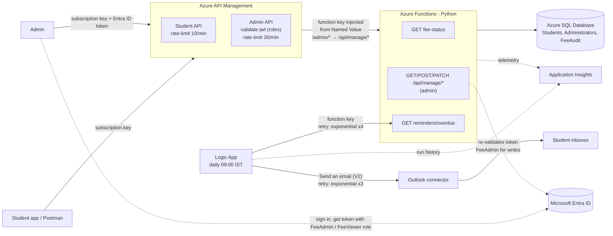

# Fee Management System on Azure

A cloud-native student fee management system:

- **Students** check their fee details and payment status (Paid, Partially Paid or Overdue) through a rate-limited API that needs a subscription key.
- **Administrators** query and update fee records through an API secured with **Azure AD (Entra ID) and role-based access control**.
- A **Logic App** emails reminders to every student with an overdue balance, every day.

The whole system is deployed and tested end to end on Azure (region UAE North). See [What was deployed](#what-was-deployed) and [Verified results](#verified-results).

## Architecture



| Requirement | How it is met |
|---|---|
| Data storage | Azure SQL Database: `Students`, `Administrators`, plus a `FeeAudit` table. CHECK constraints, and indexes for the overdue scan and course filter |
| Automation | Logic App (Consumption): daily Recurrence → HTTP call to the Function → For each overdue student → Send email |
| Serverless compute | Azure Functions (Python 3.11): fee calculation (balance, status, days overdue) and all API logic |
| API management | APIM (Consumption): two APIs, subscription keys, `rate-limit`, `validate-jwt`. The function key is held in a secret Named Value |
| Azure AD and RBAC | App registration with app roles **FeeAdmin** (read and write) and **FeeViewer** (read only). APIM validates the token and the Function validates it again |
| Scalability (5,000+ records) | Set-based SQL, covering indexes, paging (`OFFSET/FETCH`), status filtering done in SQL, and a 5,000-row load script |
| Monitoring and retries | Application Insights on the Function App. Logic App retry policies (exponential) on every external call, plus run history |

## Fee status rule

All checks use "today" in the `FEE_TIMEZONE` timezone (default Asia/Kolkata):

| Status | Condition |
|---|---|
| **Paid** | `PaidAmount >= TotalFee` |
| **Overdue** | Balance > 0 **and** `DueDate < today` |
| **Partially Paid** | Balance > 0 **and** `DueDate >= today` (still within time) |

The rule lives in `fees/fee_logic.py`, both as a Python function and as SQL predicates for filtering. A test checks that the two always agree.

## Endpoints

Callers always use the APIM URLs. The admin functions sit under `/api/manage` because Azure Functions reserves routes that start with `admin` for its own host API; APIM keeps the public `/admin/...` path and forwards it with `set-backend-service`.

| Who | Method and route (Function) | Through APIM | Auth |
|---|---|---|---|
| Student | `GET /api/students/{id}/fee-status` | `GET /student/students/{id}/fee-status` | Subscription key |
| Admin | `GET /api/manage/students?status=&course=&page=&pageSize=` | `GET /admin/students…` | Key + token (FeeAdmin or FeeViewer) |
| Admin | `GET /api/manage/students/{id}` (includes audit history) | `GET /admin/students/{id}` | Key + token (FeeAdmin or FeeViewer) |
| Admin | `POST /api/manage/students/{id}/payments` `{ "amount": 5000 }` | `POST /admin/students/{id}/payments` | Key + token (**FeeAdmin**) |
| Admin | `PATCH /api/manage/students/{id}/fees` `{ totalFee?, paidAmount?, dueDate? }` | `PATCH /admin/students/{id}/fees` | Key + token (**FeeAdmin**) |
| Logic App | `GET /api/reminders/overdue?limit=` | not exposed | Function key |
| Monitoring | `GET /api/health` | not exposed | Anonymous |

Errors share one JSON shape: `{ "error": { "code", "message", "details", "requestId" } }`. The codes are 400, 401, 403, 404, 409, 429 (from APIM), 500 (generic message, no internals leaked) and 503 (with `Retry-After`).

## What was deployed

All resources are in one resource group, `rg-feemgmt`.

| Component | Resource | Notes |
|---|---|---|
| Database | Azure SQL server `feemgmt-sql-deep`, database `feemgmt-db` | Free offer (serverless, auto-pause), SQL authentication, firewall: client IP + Azure services |
| Compute | Function App `feemgmt-func-deep` | Flex Consumption, Python 3.11, 7 HTTP functions, dependencies bundled in `.python_packages` |
| Monitoring | Application Insights `feemgmt-ai` | Linked to the Function App |
| Gateway | API Management `feemgmt-apim-deep` | Consumption tier; Student API (suffix `student`) and Admin API (suffix `admin`); subscriptions `student-demo` and `admin-demo`; Named Values `func-host-key` (secret), `tenant-id`, `api-client-id` |
| Automation | Logic App `la-fee-reminders` | Consumption; daily 09:00 IST |
| Identity | Entra ID app registration `fee-management-api` | App roles `FeeAdmin` and `FeeViewer`, scope `access_as_user`, Azure CLI pre-authorised |

Secrets are not in the repo. The function key lives only in the APIM Named Value and the Logic App; local REST Client settings (`.vscode/settings.json`) are git-ignored.

## Verified results

Tested through APIM with the VS Code REST Client (`requests.http`) and in the portal.

| Area | Test | Result |
|---|---|---|
| Student API | `GET /student/students/1015/fee-status` with subscription key | 200, Overdue, balance and days overdue |
| API keys | Same call without the key | 401 from APIM, never reaches the Function |
| Rate limiting | More calls than the limit inside a minute | 429 Too Many Requests |
| Azure AD | Admin call without a token | 401 from `validate-jwt` |
| Admin query | `GET /admin/students?status=Overdue` with FeeAdmin token | 200, `totalCount: 7` |
| Payment | `POST /admin/students/1014/payments` (30,000) | 200, status Overdue → Paid, audit row written with admin email |
| Validation | Overpayment on 1007 | 409, payment larger than outstanding balance |
| Update | `PATCH /admin/students/1015/fees` (new due date) | 200, status Overdue → Partially Paid |
| RBAC | Same payment with a FeeViewer token | Reads 200, write 403 |
| Reminders | Logic App run | 7 overdue students, 7 emails delivered (plus-addressed to one test inbox) |
| Monitoring | Application Insights | Requests, failures (403/409), SQL dependency timings, business log lines, Application map |
| Scale | 5,000 extra rows via `sql/03_load_test_5000.sql` | Paged queries stay fast; reminders still go only to the 7 real overdue students |

## Repository layout

```
function_app.py            routes only
fees/api.py                handlers, error -> status code mapping
fees/auth.py               Entra ID token validation + role checks
fees/fee_logic.py          balance / status / days overdue (+ the same rule as SQL)
fees/repository.py         all SQL access (atomic payments, audit)
fees/queries.py            parameterised SQL text
fees/validation.py         request validation (Decimal money)
fees/db.py, config.py      connections + retry, settings from environment
sql/01_schema.sql          tables, constraints, indexes
sql/02_seed_data.sql       20 students (6 Paid / 7 Partially Paid / 7 Overdue) + admins
sql/03_load_test_5000.sql  optional 5,000-row scalability test (never emailed)
sql/04_remove_load_test.sql
apim/*.openapi.yaml|json   API definitions (import the .json files into APIM)
apim/policies/*.xml        APIM policies (rate limit, validate-jwt, key injection)
logicapp/fee-reminder-workflow.json   Logic App definition (code view export)
tests/                     64 pytest tests
docs/DEPLOYMENT.md         step-by-step deployment guide
requests.http              sample calls (local and through APIM)
```

## Run locally

```bash
python -m venv .venv && .venv\Scripts\activate          # Windows
pip install -r requirements-dev.txt
pytest -q                                                # 64 tests, no Azure needed
copy local.settings.json.example local.settings.json     # fill in SqlConnectionString
func start
```

`AUTH_MODE=local-dev` takes the identity from the `X-Dev-User` and `X-Dev-Roles` headers, so admin endpoints can be tested without Entra ID. The app refuses to start in this mode when running in Azure.

## Design decisions

- **Two layers of authorisation.** API Management rejects calls without a valid token or a fee role before they reach compute. The Function validates the token again and requires **FeeAdmin** for writes, so it stays protected even if someone calls it directly. For writes, the user must also be an active row in `dbo.Administrators`, which records who made each change.
- **Payments are atomic.** `UPDATE … SET PaidAmount = PaidAmount + @amt WHERE … AND PaidAmount + @amt <= TotalFee` checks and increments in one statement, so two simultaneous payments can never overpay. A CHECK constraint backs this up in the database.
- **Every change is audited** in `FeeAudit` (old and new values, who, when), inside the same transaction as the change.
- **The rule has one definition,** in `fee_logic.py`. SQL filtering uses the same rule, and a test checks they agree for any date.
- **No secrets in code.** Settings come from app settings (Key Vault references are the next step). The function key is held only in APIM Named Values and in the Logic App's secure parameter.
- **Function routes use `/api/manage/...`, not `/api/admin/...`.** Azure Functions reserves routes starting with `admin` for its own host API, so those calls returned 404. APIM still exposes the friendly `/admin/...` path and maps it to `/api/manage`.
- **Retries everywhere it matters:** the Logic App uses exponential retry policies, and the Function retries transient Azure SQL errors (such as 40613 when the database is waking up) and then returns 503 with `Retry-After`.

## Assumptions

- `Email` was added to Students, because reminders can't be emailed without it. `Email` and `IsActive` were added to Administrators, to link a row to the signed-in Entra ID user.
- The brief defines three statuses. A student with nothing paid who isn't yet due is reported as **Partially Paid** (balance outstanding, not overdue). A separate "Unpaid" status would be a sensible addition to discuss with the client.
- The student endpoint is protected by an APIM subscription key, as Task 3 specifies. In production, students would sign in with Entra ID and the API would only return their own record.

## Issues hit during deployment

| Problem | Cause | Fix |
|---|---|---|
| APIM "Unable to parse specified file" | Placeholder `<your-function-app>` in the OpenAPI `servers` URL | Import the `.json` specs (no `servers`), set the Web service URL by hand |
| Logic App "Retry policy interval is invalid" | Trailing space in `PT15S ` | ISO 8601 durations with no spaces (`PT10S`, `PT10M`) |
| Logic App header typo | Header typed as `x-functions-key,`, which the Function would reject | Exact header name `x-functions-key` |
| Admin calls returned an empty 404 | Azure Functions reserves routes starting with `admin` | Function routes moved to `/api/manage/*`; APIM policy uses `set-backend-service` |
| 401 "valid Entra ID access token is required" | Token not saved in REST Client settings | Save `.vscode/settings.json`, select the `azure` environment |

## Next steps

- Students sign in with Entra ID, and their token is mapped to their StudentID.
- Key Vault references and managed identity to SQL, so there's no SQL password at all.
- Record `LastReminderSentAt`, so a student isn't emailed every single day, or send weekly digests.
- Service Bus between the Logic App and email, for very large batches. Durable Functions fan-out is an alternative.
- CI/CD with GitHub Actions, plus Bicep templates for the infrastructure.
